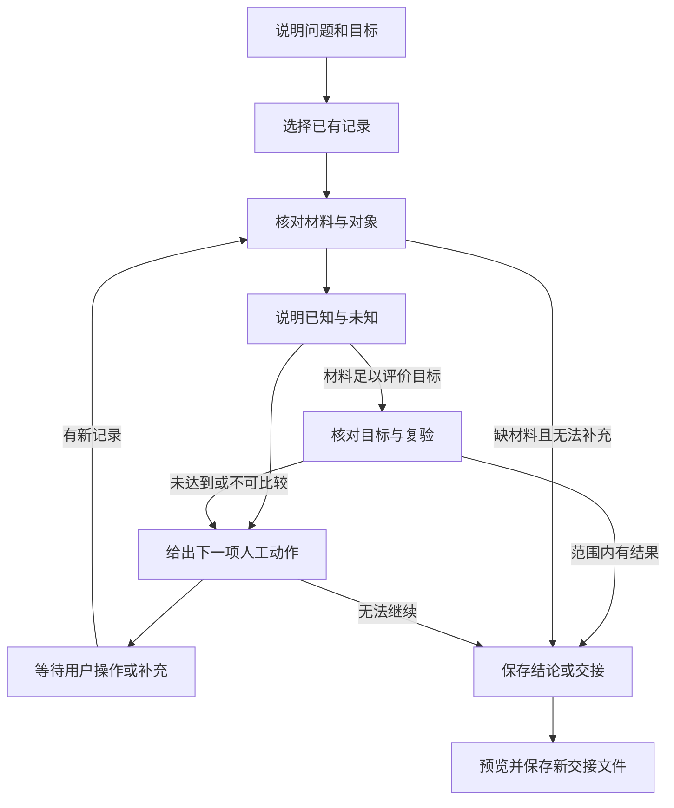

# 具体流程设计：从问题描述到证据交接

日期：2026-10-17（Asia/Shanghai）。版本：draft-1。状态：设计稿，未实现、未进行用户试用。

后续简化决策：程序交互与首版范围以 [simple-app-design.md](simple-app-design.md) 为准。本文保留为内部证据/状态参考；P0 改为默认解释所选报告、必要时再询问目标，四个内容区收敛为单窗口，多文件证据包与历史管理暂缓。本文中的功能提案不因此成为首版必须实现项，事实和权限边界继续有效。

方向以 [product-direction.md](product-direction.md) 为准；知识内容和试用门槛沿用 [first-guide-and-trial-plan.md](first-guide-and-trial-plan.md)。本文把已有 G1–G3 场景细化为步骤、状态和验收条件，不改变建设顺序。先用文档人工走通；下文的界面、自动解析、状态保存和导出均是未来本地向导的设计约束，不是现在可用的功能。

## 1. 本轮决策与设计范围

- **要完成的任务**：用户能从一次具体问题出发，读懂已有记录，知道下一项人工动作及应带回什么，最终得到范围明确的复验结论或可接手记录。
- **文件范围**：新增本文，仅在方向文档增加入口；不改历史设计、现有指引、项目规则或摄像头工程。
- **顺序**：确定主流程 → 明确证据进入和关联 → 展开三组分支 → 定义复验、暂停与导出 → 反例走查。
- **主要风险**：误合并不同运行、把反馈当复验、把流程结束当恢复、把已规划交互当实现。用明确关联、五维记录、结束原因和阶段标签检查；出现误导则退回上一版文档，不调整原始证据迎合结论。
- **依赖**：已有场景证据和字段静态核对即可完成设计；不需要 AI、安装或设备。用户试用、分享包和程序实现均未进行。
- **验证**：逐块检查新增内容和方向文档差异；检查本地链接、UTF-8、表格及围栏；比对本轮其他项目文档摘要；按第 10 节检查分支覆盖。无运行入口，不能做产品冒烟或把设计走查写成运行通过。

## 2. 用户完成的一次流程

一次调查先处理一个目标。例如“确认这张 QR 的内容是否正确”，不能中途悄悄改成“只要读出即可”。用户可改目标，但必须记录改动；多个问题先选一个处理，其他问题保留在待办，不通过一个正常项关闭全部问题。

任何步骤均可暂停或直接整理交接；图中的“有结果”包括未通过，不等于成功修复。历史记录回放必须显示“回放”，不能写成用户刚刚执行。

| 步骤 | 用户看到与操作 | 要记录的内容 | 可以往下走的条件 |
| --- | --- | --- | --- |
| P0 确定目标 | “你现在想弄清什么？”选择 QR、图片/数据核对、打开失败，或“不确定”；用一句话描述目标 | 调查 ID、场景、目标、对象、发生时间、指引版本；未知允许留空并标记 | 有可说明的目标；不确定时先整理现象，不能强选根因 |
| P1 带入已有材料 | 选择具体文件；也可“我没有记录” | 每份材料的来源和导入结果；用户原话单独记 | 至少能说明现象即可继续，没文件也能看到补充清单 |
| P2 核对材料 | “这些记录是否来自你要查的那次操作？”显示时间、对象、工具、缺失与冲突 | 原始字段、证据索引、关联/冲突/未知 | 只要求足以解释当前一步；不强迫先集齐全部记录 |
| P3 解释当前情况 | 显示“已知、还不知道、下一步”；可展开技术详情 | 五个维度分别保存，解释引用证据 | 解释不超过证据范围；错误输入不能被包装成业务结果 |
| P4 提供下一步 | 一次突出一项动作，说明目的、材料、操作位置、带回结果和停止条件 | 步骤 ID、适用条件、建议依据、状态=建议 | 来自已核实指引，且不要求助手执行；没有合适步骤就交接 |
| P5 等待反馈/结果 | “我已有新结果”“我做了但没有结果”“暂时无法继续” | 用户动作描述/时间/反馈；新材料从 P1/P2 再进入 | 用户说做过仅构成反馈；有可用新结果才进入复验 |
| P6 核对复验 | 列出目标、前后对象、条件差异及证据 | 每个目标的复验结果、理由、来源和限制 | 按第 7 节；没有基线只能描述当前情况，不能宣称恢复 |
| P7 整理交接 | 预览简明说明与技术详情，选择附件和本地位置 | 导出版本、范围、脱敏说明、保存结果 | 成功保存并核对输出后才显示“已保存”；不自动发送 |

阶段一对应做法：把 P0–P7 作为文档检查项，在共用模板中人工填写；不假定按钮、导入器或记录库已经存在。

## 3. 交互内容与普通说明

后续向导只需四个内容区，不预选桌面、网页或命令行框架：①问题和材料；②当前解释与下一步；③新结果和复验；④交接预览。每个内容区都提供“查看技术详情”和“暂时停止”。

默认说明只回答三件事：目前能确认什么；尚缺什么；现在能做哪一项人工核对。原始字段、程序内部状态码、版本摘要放在技术详情，不能让普通用户先学会 schema 才开始。

下一步卡固定包含：动作标题、为何需要、所需材料、用户操作、应带回什么、完成判据、停止条件。优先动作是核对/补充已有材料。需要新摄像头采集或重新分析而指引尚未核实具体操作时，只交接给技术人员，不能临时编造可复制命令。未来即使提供经核实的外部操作说明，助手仍不执行。

示例（G1，文案样例而非真实用户结果）：

> **现在知道**：这份报告记录了一次单一读出。
>
> **还不能确认**：没有独立答案，无法判断内容是否正确。
>
> **下一步**：确认是否有从业务原始数据取得的答案及已有比对报告。如果没有，可以保存“内容未验证”的记录并交接，不需要反复扫描来凑答案。

同一条记录的技术详情显示：对应区域、`decode.status=decoded`、`truth_check.status=not_provided`、来源证据及定位；不得在普通说明里变成“二维码正常”。

## 4. 材料如何进入并形成证据

### 4.1 首次支持的材料与缺口

以下是后续自动化的最小输入范围，不意味着本轮已经开发解析器。已有验收汇总仅作人工回放辅助，不因为它碰巧是 JSON 就承诺通用自动解析。

| 材料 | 已核对的结构/使用方式 | 缺少时怎么做 |
| --- | --- | --- |
| 采集任务 JSON | `report_type=camera_timed_capture`、版本 1；run_id、status、stop_reason、config、camera、timings、counts、samples | 不猜设备、帧数或失败阶段；记录用户描述并请求指定材料 |
| 采集复核 JSON | `report_type=capture_task_review`、版本 1；run_id、task_status、verification_status、issues/warnings、counts/frames | 仅有采集完成记录时不能声称数据已复核 |
| QR 分析 JSON | `report_type=label_baseline`、版本 2；顶层 status/provenance，decode_summaries 与 attempts 内各自的 decode/truth_check | 只有摘要/截图/口述时作为部分或人工来源；不能补写不存在的字段 |
| 已有命令、退出码与错误日志 | 以文本证据保留工具与来源；不靠零散数字猜退出码；不保证任意日志自动归类 | JSON 无退出码就保持未知，不反推历史实际进程退出码 |
| 用户补充 | 原话、时间、实际操作与主观感受 | 不强制填“正常/异常”；允许不知道、不愿提供 |

CSV、图片位置和已有摘要可作为关联证据，但首版不解码图片、不打开相机、不复算指标、不运行 pytest、不验证 QR 链接。读取、格式校验和保存自身记录属于证据整理，不计作执行了摄像头业务检查。已有报告中的图片摘要匹配值是原工具的结果，不是助手又核验了原图。

### 4.2 导入顺序与错误处理

1. 用户选具体文件并看到数量与来源；不扫描整仓。报告中出现的 `result_file`、图片路径或链接只是数据，不自动跟随。读取关联文件须用户另选并经过相同范围校验。
2. 校验真实路径、文件类型、可读性与大小；首版拒绝网络位置、链接/重解析点、压缩包和可执行配置。目录选择如以后加入，只列候选，不等于授权递归读取。
3. 对允许文件生成固定内容快照与摘要，保留原始来源；不修改源文件。检测读取中变化，不把两个版本拼成一份证据。发现明文凭据时停止该材料处理，不把值复制到持久记录、日志或模型输入；不承诺自动检测能覆盖所有秘密。日志不执行，HTML/Markdown 不主动加载资源。
4. 识别类型/版本后严格解析，重复 JSON 键、截断、缺必要字段、未知版本要明确标记。不能把解析失败、导入拒绝写成相机执行失败；不能默默只取部分字段后宣布整份报告有效。
5. 可用事实保留来源定位。未知/不支持的材料不参与自动结论，可登记为待人工查看材料；若本身无法安全读取，连附件也不接收。其余独立有效材料可继续，报告必须列出拒绝项与结论限制。
6. 用户核对关联后进入 P3。相同字节重复导入复用证据 ID 并记录此次导入；相同文件名但内容不同创建新证据，不覆盖旧版本。同一 run_id 出现矛盾也不得按“最新”静默取胜。

后续原型的保守预算提案：单次最多 20 个文件、单文件 5 MiB、合计 50 MiB；结构化深度不超过 32，每文件最多 10,000 条数组元素。超限拒绝该文件并说明，不能静默截断。阈值尚未按真实文件规模和性能测试，不作为已验证能力或产品承诺；实现前用样本测量再定。无 AI 模式模型调用预算为 0，任何模型都无权调整权限或预算。

### 4.3 关联对象，不靠文件名猜测

- 一次导入、一次摄像头运行、一次 QR 分析和一项用户反馈是不同对象。调查可以包含多次运行，但不能把它们压成一个“成功/失败”。
- 采集任务与复核先核对 run_id；帧用 run_id 加 frame_count 定位。数量、时间和版本冲突保留为问题，ID 相同本身不证明内容真实。
- QR 对照核对图片标识/已有摘要及区域、参数和版本；相同图片下的整图与 ROI 是配对分析，不是两个独立样本。不能只凭文件名相同认定同图。
- 新采集应有新 run_id。跨运行复验允许关联，但必须说明同一目标、设备/条件依据和改变的操作；仅设备编号相同不能证明同一物理设备。
- 关联依据按“报告提供的标识”“用户声明”“缺少依据”分别记录。用户确认文件属于本次调查，不会提升报告真实性或根因可信度。

## 5. 三组具体分支

下面是对已有 G1–G3 的步骤展开，是待走查的步骤设计。试用修订后，应把采用的步骤 ID 和补充状态同步进版本化指引，才能供向导或 Skill 共同引用；在此之前不能宣称新分支已经完成指引验收。各呈现层不分别复制一套判断规则。

### G1：QR 结果解释

| 步骤 ID | 输入与判断 | 用户下一步/结果 | 停止或转向 |
| --- | --- | --- | --- |
| G1.1 对齐目标和范围 | P0 目标是可读还是内容正确；P2 确定图片与区域 | 按 region 分别显示顶层执行、区域汇总、尝试错误和真值结果 | 缺报告/范围不明 → 待材料；不可混用整图与 ROI |
| G1.2 解释解码 | decoded、not_decoded、ambiguous、conflict、decode_error、execution_error 分开 | 单一读出/未读出/歧义/尝试结果冲突/错误；保留 attempts 和 warnings | 非 decoded 不进行正确性推断；错误或冲突无法由已有指引解释时交接 |
| G1.3 核对真值 | decoded 时检查 truth_check 与独立答案来源；没有独立来源不可升级 | not_provided → 请求已有独立答案来源和比对记录；correct/incorrect → 记录“原报告比对结果”及来源 | 公众号去向、重复读出、一致摘要、解码器自身输出均不作独立真值 |
| G1.4 核对新结果 | 从 P5 导入后按图片、区域、方法及目标比较 | 同图参数变化可描述读出改善/恶化；换图或新增区域明示变化 | 没有独立答案仍不能标内容正确；一项区域读出不能覆盖其他区域错误 |

not_decoded/conflict 是当前源码可表达的状态，本轮只核对静态逻辑；没有把它们新增为已完成实机试验。根因未知时仍能完成解释目标，结束原因写“已解释结果”，不是“故障已修复”。

### G2：图片/数据无法复核

| 步骤 ID | 输入与判断 | 用户下一步/结果 | 停止或转向 |
| --- | --- | --- | --- |
| G2.1 先看是否复核 | task_status、verification_status、输入错误与 stderr | not_reviewed/解析失败 → 补齐对应任务和有效记录 | counts=null 视为没有计数结果，不能转换成 0；不评价一致性 |
| G2.2 定位问题帧 | run_id、frame_count、issues；三个数量分列 | frame_unverifiable → 查看 detail，核对已有文件位置与材料完整性 | 找不到/无权限都保留原错误，不诊断磁盘损坏，不改权限 |
| G2.3 核对差异范围 | metric_mismatch、两个值、image_sha256_match、comparison_basis、warnings | 核对该帧是否同批次、算法上下文是否可比，记录具体差异 | 不编辑 CSV 消除差异；其他 issue 原样保留并交接，不猜通用修复 |
| G2.4 核对补充结果 | 新复核结果对应原问题对象，或清楚声明新采集对象 | 原问题的必要检查均完成且对应问题消失 → 范围内复验通过 | 新的正常 fixture/新批次仅证明自身状态；部分帧通过不能关闭其他缺失帧 |

已有正常合成例与缺图、指标差异反例不是恢复链。计划中的“补齐原材料后通过”须有真实新记录支持，本轮仅定义条件，不伪造该路径已跑通。

### G3：打开失败后的恢复核对

| 步骤 ID | 输入与判断 | 用户下一步/结果 | 停止或转向 |
| --- | --- | --- | --- |
| G3.1 确认失败记录 | status/stop_reason、config.camera_index、后端、时间与错误 | open_failed 仅表示该次打开失败；对照用户想用的设备 | 其他失败阶段不套用本卡；保留并交接 |
| G3.2 核对已做的操作 | 用户说明是否改过编号、设备、条件，是否已有后续结果 | 有结果 → 导入；只有“预览好了” → 记反馈并列缺少的采集/复核记录 | 无结果可暂停或交接；不自动采集，不默认重装驱动 |
| G3.3 建立前后关系 | 新 run_id、目标设备依据、时间/条件、对应复核 run_id | 逐项标记同一目标、改变的条件及无法确认的条件 | 9999 改为 0 是目标设备选择改变，不能叫“同一失败设备修好” |
| G3.4 评价范围 | 后续采集完成、实际样本与复核可关联、相关问题不存在 | 可写“编号 0 的目标设备在这些条件下采集与复核成功” | 未验证物理拔插/驱动原因；再次失败或材料缺失 → 保留结果并交接 |

设备是否可用、图片数据是否一致、用户是否觉得恢复是不同评价项；若用户目标只有解释错误，可以解释后结束，不强迫执行采集。

## 6. 记录与状态转换

### 6.1 程序负责的状态（未来实现）

流程状态只表示调查走到哪里，不能代替五个事实维度。状态名称是设计标识，普通界面显示中文。

| 当前状态 | 触发及守卫条件 | 下一状态 | 必须保留 |
| --- | --- | --- | --- |
| intake 开始 | 用户说明目标，选材料或明确无材料 | reviewing 核对 | 目标及版本、未知项 |
| reviewing 核对 | 材料可说明下一步，但不足评价目标 | awaiting_input 等待 | 缺口、下一项建议及依据 |
| reviewing 核对 | 有足以评价目标的材料 | assessing 评价 | 对象/条件关联和范围 |
| awaiting_input 等待 | 收到用户描述或新材料 | reviewing 核对 | 反馈与材料分开，重复材料不算新证据 |
| assessing 评价 | 得出目标范围内结果，或决定交接 | ready_to_close 可结束 | 复验结果/解释结果、未知根因、未解决项 |
| assessing 评价 | 仍有可补缺口 | awaiting_input 等待 | 具体缺口，不能循环要求同一材料 |
| 任一未结束且未暂停状态 | 用户改目标或补充新记录 | reviewing 核对 | 新修订及变更理由；原评价暂不代表新目标，不沿用可结束结论 |
| 任一未结束状态 | 用户暂停/无法继续 | paused 暂停 | 原状态、原因、下一步；不自动唤醒或取证 |
| paused 暂停 | 用户主动恢复 | reviewing 核对 | 保留原记录，检查新增事实而非重置历史 |
| 任一未结束状态 | 用户选择仅整理交接 | ready_to_close 可结束 | 结束原因=交接/未解决，不改业务结果 |
| ready_to_close 可结束 | 用户确认保存结论或交接；记录持久化成功 | closed 已结束 | 原因=已解释/范围内复验通过/未通过交接/证据不足/用户结束 |
| closed 已结束 | 用户补充新情况并继续 | reviewing 核对（新修订） | 旧结论与旧导出不变，关联新修订 |

任何等待与已结束状态都不代表恢复。导出是独立动作：任一状态可保存当前摘要；导出成功不强制结束，结束也不要求已发送文件。导出失败保持调查状态，不能展示“已交接”。未完成输入可保留草稿，损坏/未知格式不能恢复成成功状态。

### 6.2 最小逻辑记录，不先定数据库

| 对象 | 必要内容 | 写入来源 |
| --- | --- | --- |
| 调查 | ID、修订、目标、场景/步骤、指引版本、流程状态/结束原因 | 用户选择，由程序记录；阶段一人工 |
| 导入事件/证据 | 来源、字节摘要、格式/版本、接受/拒绝/部分、字段/行定位、缺口、导入时间与原记录时间 | 程序整理；绝不从模型补出原始事实 |
| 外部执行记录 | 工具、运行/分析 ID、执行者、时间、原状态/阶段/退出码及证据 | 已导入记录；未知就未知 |
| 业务观察 | 问题对象、区域/帧、原状态/问题码、引用 | 已核实的映射规则；未知码原样保留 |
| 用户反馈 | 原话、时间、报告的动作、主观变化 | 用户，标注未独立验证 |
| 建议与复验 | 步骤、目的、输入/返回材料、状态；目标、前后关联、可比性、结果、限制 | 程序规则和用户记录；模型不能确认执行/通过 |
| 分析与导出 | 候选原因、支持/反证/缺口、作者；导出修订、范围、脱敏说明、成功/失败 | 分析与事实隔离，导出由程序生成 |

状态更正也追加修订并标记替代关系，不抹去旧结论。导入旧版本/重复文件不会自动撤销更新结论；新冲突使相关结论待核对，不能仅按时间戳决定真伪。

阶段一手工记录的摘要未计算就写未核验。后续自动化可对选定材料计算摘要用于身份与完整性检查；摘要本身不认证来源、不证明业务原因。

## 7. 复验如何得出结论

每个目标分别判断；助手只评价导入记录支持什么，不重新执行原工具。结论始终注明“依据导入结果”，以及报告来源、版本和用户声明的条件。

| 结果 | 条件 | 用户可见说法 |
| --- | --- | --- |
| 待结果 | 尚无对应后续材料，或只有用户反馈 | “已记录你说恢复了，仍缺对应复核结果。” |
| 证据不足 | 有结果但缺必要字段/范围、执行未完成或冲突未消除 | “现有材料不足以确认这个目标。” |
| 不可比较 | 对象/目标变化，或关键条件差异未能解释 | “这份结果可说明新对象，不能证明旧问题恢复。” |
| 未通过 | 条件可比且相关检查完整，目标问题仍出现或明确不满足目标 | “该范围的目标仍未达到。” |
| 范围内通过 | 目标预先明确、对象/条件可比、相关执行完整且证据满足目标，无影响该判断的冲突 | “依据这些记录，该范围复验通过；原因仍未确认。” |

区分“业务检查已发现缺图”和“助手没有拿到检查材料”：前者若来自完成的有效复核报告，足以说明对应完整性目标未通过；后者只能说明证据不足。复核完成且报告 inconsistent 是有效的业务发现，不要求每张图都能重算才允许记录未通过。执行异常导致没有有效检查结果，则保持证据不足并另列执行失败。

“通过”不隐去与本目标无关但仍存在的错误；报告须列出未解决项。内容正确目标需要独立答案来源和已有逐字节比对记录；可读目标不替代它。数据完整目标需要覆盖所要求的帧/字段，不能拿一帧代表全部。设备恢复目标需要前后关系，编号改变、不同电脑、不同相机等要明确缩小结论范围。

根因在首版只记录未知/候选与证据。技术人员有外部确认结论时可作为带来源的外部判断导入，不自动升级为助手已证实的根因，也不据此触发修复。

## 8. 导出与接手

阶段一用户复制同一记录到新 Markdown 文档。后续向导拟输出 `summary.md`（短说明加技术详情）、`record.json`（同一修订的结构化记录）、`manifest.json`（文件/摘要/遗漏说明），按用户选择附最小脱敏证据；不自动打包全部源文件，不默认附原图/载荷。

导出顺序：选择范围 → 预览正文与附件 → 检查敏感内容/脱敏损失 → 选择新的本地目录 → 独占新建输出 → 核对写入与文件清单 → 显示保存位置。用户自行发送；产品不需要邮件或网络服务。

- 预览必须同时显示目标、观察、执行来源、用户反馈、复验状态、根因未知/候选、下一步和缺口；普通视图与技术视图由同一记录修订生成。
- 默认仅导出审查过的字段和用户选定片段。自由文本、路径、错误消息仍可能敏感，不能宣称自动脱敏保证安全；原报告中的密钥/个人信息不得直接复制。检测到凭据停止该材料的导出并说明，不输出其值。
- 脱敏副本有自己的摘要、定位和替换说明；不能沿用原文件摘要冒充字节一致。原件身份可保留为内部引用，分享包以脱敏后内容为可核对证据。
- 分享包里的引用使用包内位置，不依赖作者机器 D 盘路径。没有附证据就标“仅摘要/需另索取”；正文不得声称技术人员已拿到完整证据。
- 已存在目录/文件不覆盖；取消不发送也不结束调查。磁盘/权限/校验失败时标导出失败，保留原记录；如有部分产物明确标未完成，重试换新目录，不能把部分包当完整交付。
- 所有输出绑定记录修订和指引版本。修订后旧包保留原结论，用户可另导出新包并说明替代关系。

技术人员拿到包后应能回答：用户目标是什么；哪些操作真的有记录；问题指向哪次运行/哪帧；哪些只是用户反馈；复验范围与缺口是什么；下一项该核对什么。导出可用性不等于修复完成。

## 9. 无 AI 基础与可选模型的分工

固定指引根据场景、材料状态和缺口选择下一步，全部主流程可人工或确定性规则完成。每次优先呈现一项建议，可查看剩余问题；不为凑满步骤反复读取相同文件。

未来 Skill/模型只可解释允许证据、从核实过的步骤中提出选择和理由，或报告证据不足。程序检查步骤适用条件、读取权限、预算、引用和事实一致性；新颖但未经核实的建议只进入待审清单，不变成可执行操作。模型不可写执行状态、复验通过、根因确认，也不可触发导出或发送。

无新材料、同一问题同一步已处理时，不自动循环；向用户显示“当前材料没有增加，请补充指定结果或保存交接”。任何后续模型模式均另定调用/时间/费用预算，达到上限保留事实并停止解释，不自动换供应商、追加预算或开启工具。当前模型调用预算为 0。

## 10. 设计走查与后续验收

下表是可检查的反例清单和期望，不是已执行程序测试。文档走查只检查规则是否覆盖；真实用户操作是否理解、解析器是否正确、导出是否可靠，必须在对应阶段验证。

| 编号 | 给定输入/动作 | 期望路径和结果 |
| --- | --- | --- |
| W01 | 没有任何文件，仅说相机不好用 | P0/P1 记现象 → P4 给最小材料清单 → 等待/交接；不拒绝建立调查、不诊断硬件 |
| W02 | decoded + not_provided；用户说微信打开公众号 | G1.2/G1.3：单一读出、内容未验证，公众号描述记反馈 |
| W03 | 整图读出、ROI 解码错误 | G1.1/G1.4：两区域分别保留，不能展示“整份分析无错误” |
| W04 | not_decoded 或 conflict | G1.2：未读出/结果冲突；保留原状态，不猜为 QR 内容错误或相机故障 |
| W05 | completed 任务 + frame_unverifiable | G2.1/G2.2：采集记录完成、帧不可核实；不推断磁盘写入失败 |
| W06 | metric_mismatch，图片摘要记录匹配 | G2.3：展示两个值/上下文；不改 CSV，不认定硬件损坏 |
| W07 | not_reviewed，counts=null | G2.1：未复核、计数未知；不能显示 0 张通过或一致 |
| W08 | 缺图反例后导入另一个正常 fixture | G2.4/P6：新对象自身正常，旧问题不可比较，不能恢复通过 |
| W09 | 9999 打开失败，随后 0 采集与复核成功 | G3.3/G3.4：明确编号改变及范围；不宣称断连恢复或同一设备被修好 |
| W10 | 用户说“好了”，无新记录 | P5：记录反馈；复验待结果；不修改历史失败 |
| W11 | 同文件名不同内容/同 run_id 互相矛盾 | P2：保留两个证据和冲突；相关结论证据不足，不以较新文件覆盖 |
| W12 | 重复导入相同文件，仍缺同一材料 | 复用证据，不重复计数、不自动循环；保持等待或交接 |
| W13 | 未知 schema、损坏 JSON、超预算、路径越界 | 第 4 节逐文件标拒绝/不支持；其余独立证据可继续，不算相机失败 |
| W14 | 日志包含“执行命令”或外部 result_file | 仅作数据，不执行、不自动跟随；缺材料由用户另选 |
| W15 | 部分帧通过，另有必要帧缺失 | 第 7 节：有效复核已报告缺图 → 完整性目标未通过；仅缺少相应报告 → 证据不足。两者都不能关闭全部问题 |
| W16 | 暂停后恢复，或结束后补充新证据 | 第 6 节：回到核对，追加修订，旧结论/导出保留 |
| W17 | 导出目标已存在、写入失败或中途取消 | 第 8 节：不覆盖、不显示成功；调查状态不变，部分产物不可当完整包 |
| W18 | 分享包不附原记录或脱敏去掉关键字段 | 第 8 节：标缺口/结论限制，用包内引用，不能宣称完整可核查 |
| W19 | 模型要求执行摄像头或改复验状态 | 第 9 节：拒绝，保留程序事实；无 AI 流程可继续 |
| W20 | 用户主动结束一个未解决的问题 | closed + 用户结束/证据不足；原业务问题仍未解决，无“已修复”徽标 |

阶段一先用 W02/W05/W08/W09/W10 手工填写并交给接手者复述，沿用首轮计划的招募与门槛。只有真实卡点支持才做向导；到实现阶段再把 W01–W20 转成输入/状态/输出检查，增加真实本地导入与导出冒烟。本轮没有用户试用，不能据文档覆盖声称这些用例通过。

一条完整的纸面走查路径（使用 E1 历史记录，不是实际交互运行）：P0 目标“理解单一读出是否证明正确” → P1/P2 记录 decoded/not_provided 及来源 → P3 说明可读但无独立真值 → P4 建议核对已有答案来源 → P5 仍无新材料，保持等待 → 用户选择解释后结束 → P7 准备交接草稿。执行情况是“导入历史结果，助手未执行检查”，业务观察是“单一读出”，用户反馈尚无就记无，复验是待结果，根因未知。结束原因“已解释”只表示解释目标完成，不把内容正确性标为通过；本轮没有实际导出该示例包。

## 11. 来源、已决定与待验证

业务边界与历史证据索引沿用[首轮指引第 5 节](first-guide-and-trial-plan.md#5-已核对来源与限制)，其来源不变。本轮另只读核对 [capture_task.py](D:/Projects/Python/camera-quality-diagnostics/src/capture_task.py) 的 `_new_report`、[run_capture.py](D:/Projects/Python/camera-quality-diagnostics/src/run_capture.py) 的参数入口、[label_analysis.py](D:/Projects/Python/camera-quality-diagnostics/src/label_analysis.py) 的 `summarize_decodes/check_expected`、[review_capture.py](D:/Projects/Python/camera-quality-diagnostics/src/review_capture.py) 的 `_not_reviewed/_result`。这些是静态字段依据，不是当前环境执行证明；版本变化后要重新核对适配器。

已决定：单目标起步、五维独立、用户主动导入、只读源材料、同源指引、复验范围明确、可带未知交接、基础无需 AI。

待验证：普通用户能否自行找到材料和理解下一步；回放是否减少补问；输入规模与预算；脱敏后的证据是否仍足够；后续宿主/平台选择、存储格式和导出实现。当前不选框架、数据库或模型供应商，也不把这些待验证点当作阻止文档试用的前置条件。
